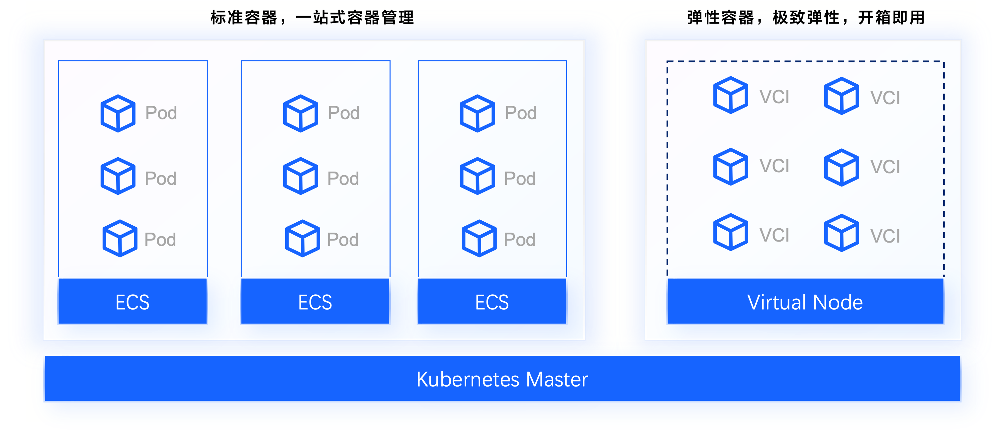
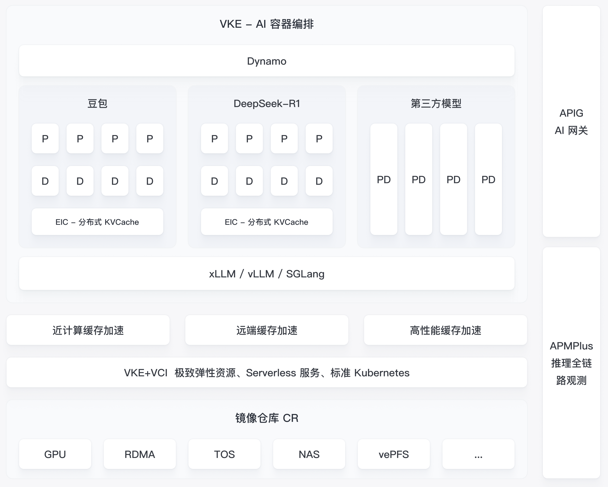
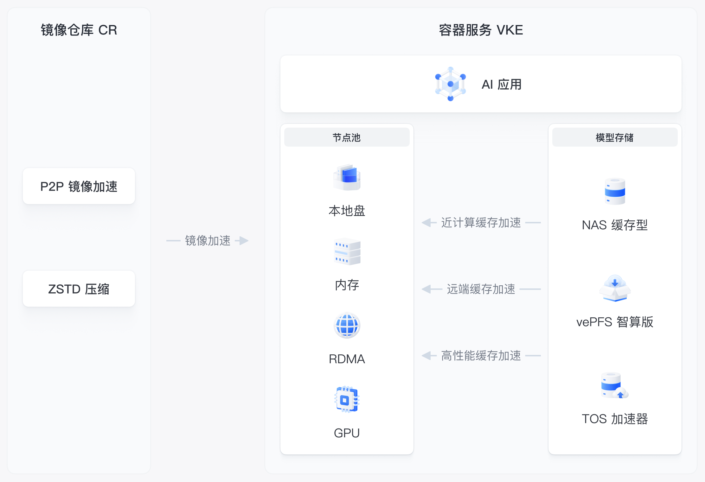
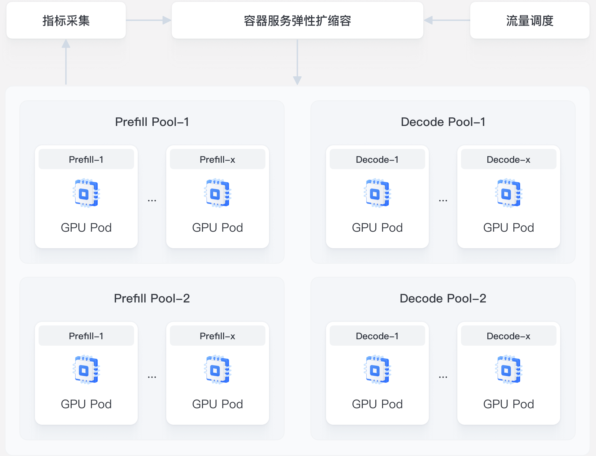

容器服务（Volcengine Kubernetes Engine，VKE）通过深度融合新一代云原生技术，提供以容器为核心的高性能 Kubernetes 容器集群管理服务。在云端一键构建高可用 Kubernetes 集群，并实现容器化应用的可视化全生命周期管理，助力用户快速构建容器化应用。

## 为什么选择容器服务

容器服务作为托管在云端的容器集群管理产品，深度整合了火山引擎高性能计算（ECS/裸金属）、网络（VPC/EIP/CLB）、存储（EBS/TOS/NAS）等服务，并与 [镜像仓库](https://www.volcengine.com/docs/6420/68643)、[持续交付](https://www.volcengine.com/docs/6461/70636)、[托管 Prometheus](https://www.volcengine.com/docs/6731/106488)、[日志服务](https://www.volcengine.com/docs/6470/73638)、[微服务引擎](https://www.volcengine.com/docs/6738/109010) 等云产品横向打通，实现了云原生应用的构建、部署、发布、监控等全链路流程。满足用户应用微服务改造、DevOps 持续交付、机器学习、海量快速弹性伸缩等场景的需求。与自建 Kubernetes 相比，主要的区别和优势如下表所示。

|功能 |容器服务 VKE |自建 Kubernetes |
|---|---|---|
|集群管理 |支持通过控制台快速创建集群，支持 GPU 云服务器和弹性裸金属服务器。提供经过稳定测试和安全加固的 Kubernetes 版本。 |需要手动部署集群，并自行探索和开发。 |
|网络管理 |提供高性能的网络插件，支持多种网络模型。 |需要选择社区网络插件进行适配。 |
|存储管理 |支持火山引擎 EBS、TOS、NAS 等多种类型存储，提供标准 CSI 组件。 |需要自行搭建存储，并开发 CSI 接入。 |
|应用管理 |支持灰度发布、蓝绿发布。支持应用监控、弹性伸缩。 |需要自行探索和开发。 |
|运维管理 |支持 Kubernetes 版本一键升级，支持集群手动和自动弹性伸缩。支持高性能日志采集 Agent，实现容器、组件、控制面等多维度日志采集。对接托管 Prometheus 服务，实现集群、组件、应用监控。 |需要手动部署监控、日志系统。 |
|服务保障 |火山引擎专业的容器支持团队，支撑了字节跳动内部海量业务的正常运行，积累了大量最佳实践和管理经验。提供服务可用性等级指标及赔偿方案 SLA。 |需要组建专业的服务团队，无 SLA 保障。 |
|安全管理 |满足不同隔离级别，完全托管，默认安全加固。结合全方位网络安全隔离管控和细粒度的访问控制，实现服务和数据的安全性和高可用性。 |自行保障环境安全。 |
|横向产品 |支持横向对接多种类型的云产品，打通 DevOps、机器学习等场景，包括：镜像仓库、持续交付、托管 Prometheus、日志服务、微服务引擎、大数据产品等。 |需要自行搭建和打通横向产品。 |

## 容器类型

VKE 支持基于 ECS 和 VCI 构建集群，也允许在集群中同时使用 ECS 和 VCI 基础资源，方便用户根据业务要求，灵活选用业务的部署方式。并在此基础之上提供标准的 Kubernetes 应用调度、编排和可观测能力。

不同类型容器的区别和特点，如下表所示。

|容器类型 |标准容器 |弹性容器 |
|---|---|---|
|基础设施 |云服务器（ECS） |弹性容器实例（VCI） |
|主要特点 |* **节点类型丰富**：支持 x86、异构、裸金属等类型的节点，节点种类和规格丰富。  * **一站式容器管理**：支持容器级别的应用调度、日志、监控和运维管理。实现容器应用的部署、发布、监控等一站式管理。  * **mGPU 多卡共享**：单个容器可使用同一节点上的多张 GPU 卡共同提供算力和显存资源，打破同一个容器使用算力/显存局限于一张 GPU 卡的束缚，提高 GPU 碎片化资源利用率。  * **调度能力增强**：支持 Gang 调度、Capacity 调度、负载感知调度、拓扑感知调度等，提供丰富的容器调度能力。 |* **开箱即用**：只需提交容器镜像，即可部署应用，无需规划和创建节点。您可以专注于业务领域创新。  * **极致弹性**：秒级弹性伸缩，无需提前预估集群容量和业务流量，不会因为集群容量不足而导致伸缩失败。  * **安全隔离**：基于安全沙箱容器构建，提供虚拟机级别的安全和资源隔离能力，各实例运行在独占内核中，并且不与其他实例共享基础设施资源。  * **降低成本**：按需创建，按量计费，不运行不计费，没有资源闲置费用，为您带来更低的使用成本。 |
|计费方式 |按量计费，根据基础设施资源使用情况，固定计费。 |按量计费，按资源用量弹性付费，不使用不计费。 |
|应用场景 |* 应用微服务化改造。  * 敏捷开发加速迭代。  * DevOps 持续交付。  * 海量快速弹性伸缩。 |* **高弹性业务**：有显著波峰波谷的业务，如直播、电商、社交等。  * **任务型业务**，例如：     * 数据处理类：大数据计算、机器学习、科学计算。     * 事件驱动类：视频录播、转码、IoT 等。     * CI/CD、GitLab Runner、Jenkins。  * **在线业务托管** |

> **说明**

> 弹性容器实例的更多介绍和使用限制，请参见 [什么是弹性容器实例](https://www.volcengine.com/docs/6460/76908)。

## 产品架构

**推理架构**

深度融合新一代云原生 AI 技术，为 AI 负载提供部署加速、应用编排、资源调度等能力。

**模型加速**

基于 P2P 技术和模型加载工具，实现百台 GPU 分钟级部署 DeepSeek\-R1\-671B 完整模型，极大缩短模型部署时间。

**PD 分离**

Prefill\-Decode（PD）分离动态调整，复合指标指导精准扩缩。

## 学习资源

* [成长地图](https://www.volcengine.com/docs/6460)

* [基本概念](https://www.volcengine.com/docs/6460/79641)

* [快速入门](https://www.volcengine.com/docs/6460/100916)

* [常见问题](https://www.volcengine.com/docs/6460/97705)

* [云服务依赖关系](https://www.volcengine.com/docs/6460/100914)

* [Kubernetes 官网](https://kubernetes.io/)
