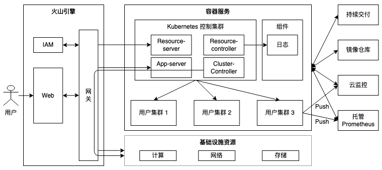
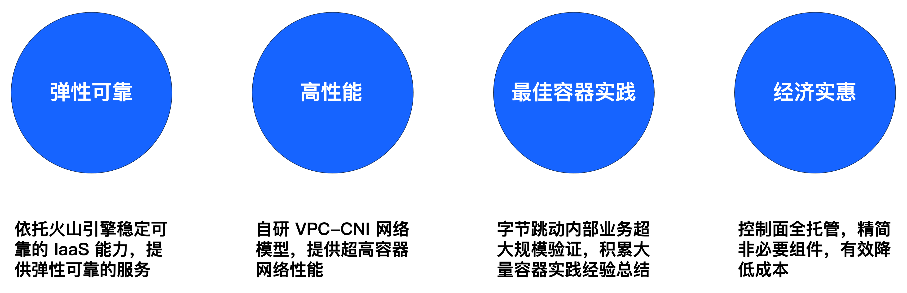

容器服务（VKE）产品具有简单易用、灵活扩展、高可用性、安全可靠等优势，可以帮助您快速构建和部署容器化应用，提高业务的效率和质量。本文主要介绍容器服务的产品优势，以及与自建 Kubernetes 的对比关系。

## VKE 优势

### 赋能 AI

* AI 应用编排：vLLM、SGLang、Dynamo 等多种框架的推理服务编排，为 AI 场景提供高效的部署能力。

* AI 模型加速：模型缓存加速，AI 镜像快速加载，提升模型性能。

* GPU 资源混部：支持 GPU 在离线任务错峰出让资源和多模型混部，提升 GPU 资源利用率。

* 资源弹性伸缩：支持 Prefill\-Decode（PD）实例的独立扩缩，降低弹性时延、提升 Token 吞吐能力。

### 可视化交互

* 构建符合用户使用习惯的交互界面，搭配友好的向导式操作引导。

* 简化集群管理及容器化应用构建等相关功能的操作逻辑。

* 可视化管理节点全生命周期。

* 提高容器业务部署效率。

* 实时观测底层资源使用情况，以及众多细粒度的资源监控，提高应用的管理效率。

### 简单易用

* 提供一站式服务，管理容器化应用的全生命周期，包括构建、部署、监控、运维等，让用户可以更加专注于业务开发。

* 通过可视化交互界面一键创建 Kubernetes 集群，支持管理多规格节点，支持虚拟机与物理机混用场景。

* 通过 Web 界面一键升级集群、节点的 Kubernetes 版本。

* 深度集成 Helm 标准模板，真正实现开箱即用。

### 极致弹性

* 提供灵活扩展能力，支持水平扩展，可以根据业务需求灵活调整资源配置，提高系统的扩展性和可靠性。

* 提供高性能、高可靠、极致弹性的企业级容器管理能力，支持云上云下资源统一管理、容灾、跨云弹性等分布式云原生能力。

* 无缝集成弹性容器实例（VCI），提供 Kubernetes 编排能力，支持秒级启动、高并发创建、沙箱容器安全隔离等能力。

   > **说明**

   > 在 VKE 基础上使用 VCI，让您更专注于构建应用本身，而无需购买和管理底层云服务器等基础设施，并仅为容器实际运行消耗的资源付费。更多信息，请参见 [什么是弹性容器实例](https://www.volcengine.com/docs/6460/76908)。

* 通过 Web 界面快速配置弹性伸缩策略，轻松实现节点和工作负载的扩缩容，以应对业务高峰期的多变、突发流量浪涌。

### 稳定可靠

* 全面托管的容器集群环境，控制面高可用设计，支持容器的自动恢复和高可用性配置，最大化保障用户集群容器化业务的稳定性与可用性。

* 提供丰富的安全机制，包括网络隔离、访问控制、镜像安全等，保证应用的安全性。

* 支持全方位网络安全隔离管控和全链路数据加密，提供 IAM 和 RBAC 权限体系的联动，支持细粒度的权限管理和完备的审计能力。

* 基于火山引擎云监控、托管 Prometheus 服务等云产品，提供高效可靠的 Kubernetes 系统可观测性能力。

### 丰富的调度能力

* 拓展原生 kube\-scheduler 调度器的调度能力及策略，支持配置节点、GPU 显卡的 Binpack/Spread 策略。

* 提供 Gang 调度、Capacity 调度等多种任务调度能力，提升容器应用的执行成功率以及集群资源的利用率。

* 支持通过自定义资源策略（ResourcePolicy），设置弹性资源优先级调度策略，满足具有优先级顺序的业务应用场景。

* 通过参考节点负载的历史统计，利用负载感知调度能力，将 Pod 优先调度到负载较低的节点，实现节点负载均衡的目标。

* 基于 Katalyst 增强 Kubernetes 资源管理能力，提供拓扑感知调度，提升资源利用率，降低成本。

### 全面拥抱云原生

基于业界主流的 Kubernetes 实现，完全兼容原生 Kubernetes API 和 Kubectl，为容器化应用提供快速部署、策略调度、服务发现和动态伸缩等一系列完整功能。

### 无缝集成

无缝对接火山引擎持续交付、镜像仓库、日志服务、托管 Prometheus 服务（VMP）、云监控等，提供一站式容器管理。

## VKE 与自建 Kubernetes 对比

火山引擎容器服务拥有 Kubernetes 一致性认证，完全兼容原生 Kubernetes，与自建 Kubernetes 相比，容器服务依托火山引擎稳定可靠的 IaaS 能力，提供多种工作负载支持，支持快速弹性伸缩能力，帮助用户提高资源利用率。同时自研 VPC\-CNI 插件将容器网络与 VPC 打通，无性能损耗，显著提升容器网络性能。结合字节跳动内部大规模容器实践经验，输出了一整套完善的容器最佳实践，能够支撑大规模集群和高弹性场景。

火山引擎容器服务和自建 Kubernetes 集群优劣势对比关系，如下表所示。

|对比项 |火山引擎容器服务 |自建 Kubernetes |
|---|---|---|
|成本 |* 集群 Master 全托管。  * 提供专业服务。 |* 集群 Master 资源消耗大。  * 需要投入大量研发、运维成本。 |
|弹性 |提供高性能、高可靠、极致弹性能力，包括：   * 支持 HPA（Horizontal Pod Autoscaling）。  * 支持 ClusterAutoscaler。  * 支持无缝集成火山引擎弹性容器实例（VCI），提供 Serverless 和容器化的计算服务。 |支持 HPA。 |
|云服务融合 |融合火山引擎的应用型负载均衡（ALB）、负载均衡（CLB）、文件存储（NAS）、对象存储（TOS）、日志服务、服务网格（AMS）等，提供完整的云上容器托管能力。 |自建对接。 |
|实践经验 |* 大量用户验证。  * 复用字节跳动海量计算存储资源，实现更极致的弹性和性价比。 |自己摸索踩坑。 |
|性能与优化 |* 高性能服务器。  * VPC\-CNI 网络性能提升。 |网络损耗大。 |
|安全 |* 专业云安全中心。  * 镜像漏洞扫描。 |* 人工修复。  * 处理不及时。  * 周期较长。 |
