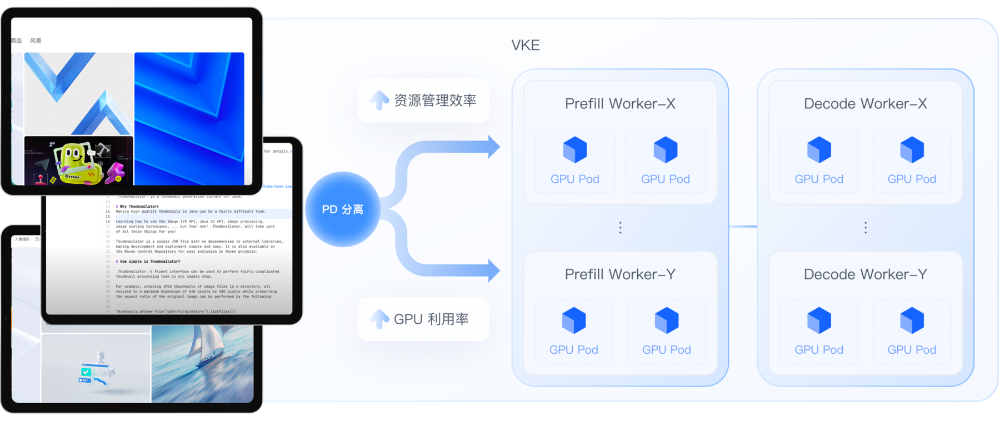
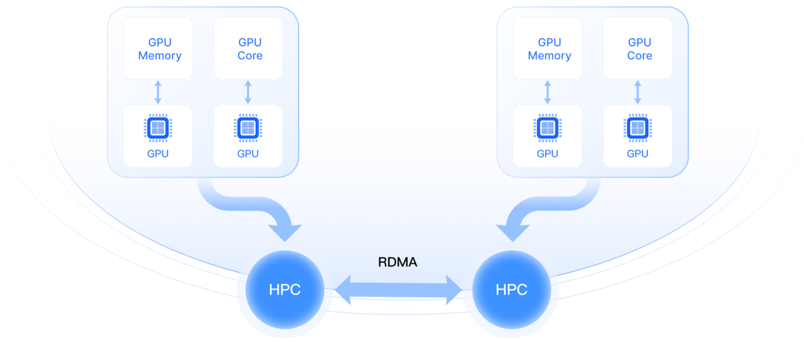
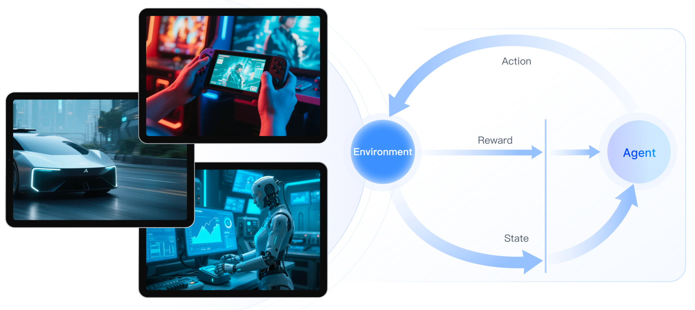
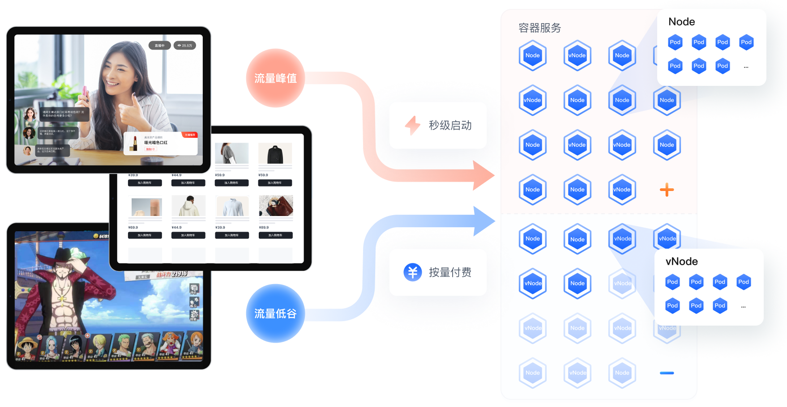

本文主要为您介绍火山引擎容器服务（VKE）的常见应用场景。

## 分布式推理

通过 Prefill\-Decode（PD）分离编排，提升资源管理效率；支持 PD 实例独立动态扩容，提升 GPU 利用率。

## AI 训练

通过容器服务实现 AI 训练任务的分布式调度与管理，支持多节点 GPU 资源动态分配和弹性扩缩容。

## 强化学习

多角色灵活编排与弹性高并发调度，提升训练效率；集群诊断与自愈，保证训练稳定性。

## 高弹性业务

为直播、电商、游戏等负载剧烈波动的业务提供按需使用、秒级弹性、稳定可靠的资源支撑。

* 根据业务流量自动弹性扩容或弹性自愈，保证业务平稳健康运行。

* 无缝集成弹性容器，海量实例秒级启动，灵活应对业务高峰。

* 使用 [弹性容器实例](https://www.volcengine.com/docs/6460/76908)，专注于构建应用本身，无需购买和管理底层服务器等基础设施。

   

## 应用微服务化改造

* 对传统单体应用进行容器化微服务改造，提高业务模块可变更、可运维、可扩展能力。

* 支持业务灰度发布、弹性伸缩和全链路数据监控，提高企业生产力。

* 与微服务集成，通过快速更新、快速迭代、快速部署等容器特性，帮助微服务在企业生产环境顺利实施。

## 敏捷开发加速迭代

* 基于代码源自动完成代码编译、镜像构建、灰度发布、应用部署。

* 搭建容器镜像服务为 DevOps 提供基础能力，使其能够基于代码源自动完成代码编译、镜像构建、灰度发布、应用部署，实现一站式容器应用交付。

* 自动化实现从代码变更、镜像构建、应用交付、应用部署、应用运维的 DevOps 全流程，助力新功能敏捷上线，降低生产测试环境差异化，加快业务迭代。

## 多云部署互联互通

* 基于"多云多活"能力，将私有云与公有云环境打通并统一管理，实现应用与数据在云上云下无缝迁移。

* 支持运维管理多种异构云端资源，实现资源的跨云调度、业务的灵活容灾。
