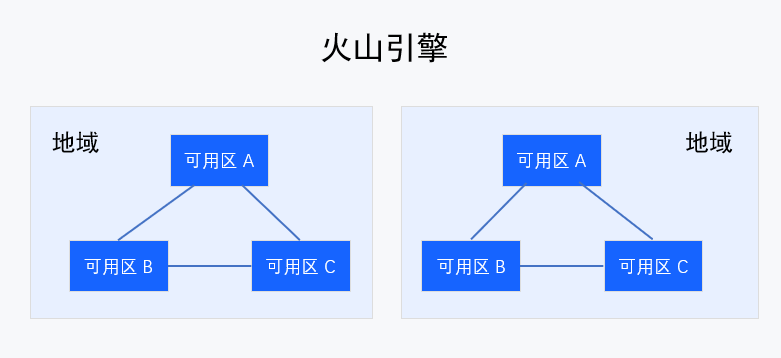

本文为您介绍地域和可用区之间的关系，地域和可用区的选择方法，以及容器服务的开服地域。

## 什么是地域、可用区

通常用地域和可用区来描述物理数据中心的位置。地域之间完全独立，可用区之间完全隔离，但同一地域内可用区之间使用低延时链路相连。地域和可用区之间的关系如下图所示。

* **地域（Region）** ：指物理数据中心所在地理区域，资源创建后不支持更换地域。不同地域之间内网完全隔离，保证不同地域间最大程度的稳定性和容错性。

   * 从地理位置的角度来讲，通常建议就近选择靠近您或者您的目标用户的地域，以减少网络时延，提高访问速度。

   * 从资源价格的角度来讲，不同地域的资源价格可能存在差异。若您或者您的目标用户在中国大陆，可以不用考虑不同区域造成的网络时延问题，因为在基础设施、BGP 网络品质、资源的操作与配置等方面，中国大陆各个区域间区别不大。

* **可用区（AZ）** ：Availability Zone，是指同一地域内电力和网络互相独立的物理区域。是否将资源放在同一可用区内，主要取决于您对容灾能力和网络时延的要求。

   * 同一地域内可用区与可用区之间内网互通，可用区之间能做到故障隔离。如果您的服务需要容灾能力，建议部署在同一地域的不同可用区内。

   * 同一可用区内实例之间的网络延时更小。如果您的服务之间需要更低的延时，建议部署在同一可用区内。

## 地域和可用区列表

容器服务产品的开服地域、RegionID 及对应的可用区对照关系如下：

|地域 |RegionID |ZoneID |发布状态 |
|---|---|---|---|
|华北2（北京） |cn\-beijing |可用区 A：cn\-beijing\-a |商用 |
|||可用区 B：cn\-beijing\-b |商用 |
|||可用区 C：cn\-beijing\-c |商用 |
|||可用区 D：cn\-beijing\-d |商用 |
|华南1（广州） |cn\-guangzhou |可用区 A：cn\-guangzhou\-a |商用 |
|||可用区 B：cn\-guangzhou\-b |商用 |
|||可用区 C：cn\-guangzhou\-c |商用 |
|华东2（上海） |cn\-shanghai |可用区 A：cn\-shanghai\-a |商用 |
|||可用区 B：cn\-shanghai\-b |商用 |
|||可用区 C：cn\-shanghai\-c |商用 |
|||可用区 D：cn\-shanghai\-d |商用 |
|||可用区 E：cn\-shanghai\-e |商用 |
|亚太东南（柔佛） |ap\-southeast\-1 |可用区 A：ap\-southeast\-1a |商用 |
|||可用区 B：ap\-southeast\-1b |商用 |
|||可用区 C：ap\-southeast\-1c |商用 |
|亚太东南（雅加达） |ap\-southeast\-3 |可用区 A：ap\-southeast\-3a |商用 |
|||可用区 B：ap\-southeast\-3b |商用 |
|||可用区 C：ap\-southeast\-3c |商用 |
|中国香港 |cn\-hongkong |可用区 A：cn\-hongkong\-a |商用 |
|||可用区 B：cn\-hongkong\-b |商用 |

> **说明**

> 容器服务在不同地域的功能支持程度可能存在不同，请以实际支持的地域为准。
