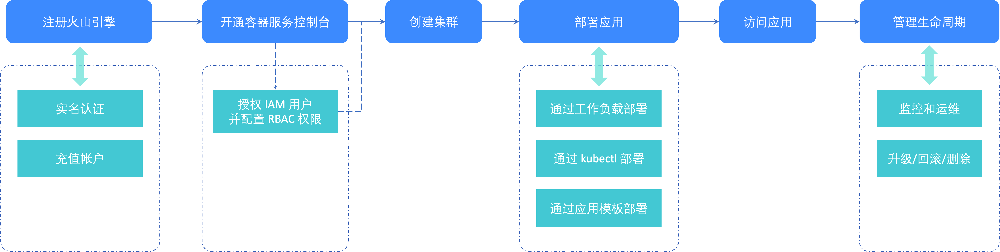

本文旨在帮助您了解容器服务（Volcengine Kubernetes Engine，简称 VKE）的基本使用流程，快速上手容器服务。

## 使用流程

容器服务的使用流程如下图所示。

1. 注册火山引擎账号并开通容器服务的控制台权限。

   使用容器服务前，您需要注册火山引擎账号，并开通容器服务的控制台权限。详细操作，请参见 [准备工作](https://www.volcengine.com/docs/6460/100918)。

2. （可选）创建和授权 IAM 用户。

   多角色管理容器服务业务时，需要创建 IAM 用户，并授权 IAM 用户相应的容器服务产品权限，同时也可以配置 RBAC（Role\-Based Access Control）权限。详细操作，请参见 [准备工作](https://www.volcengine.com/docs/6460/100918)。

3. 创建集群。

   从创建一个集群开始，使用容器服务。如果您需要快速创建集群，请参见 [创建集群](https://www.volcengine.com/docs/6460/70626#.5q2l6aqk5LiA77ya5Yib5bu66ZuG576k)。

4. 部署工作负载（应用）并查看部署状态，访问应用。

   容器服务提供多种部署应用的方法：

   * [通过控制台使用容器服务](https://www.volcengine.com/docs/6460/70626)：通过控制台中的 **工作负载** 模块，部署您的容器应用到集群中。**工作负载** 模块提供基于 Kubernetes 原生能力的白屏化操作，满足多种类型负载的全生命周期管理。

   * [通过 kubectl 使用容器服务](https://www.volcengine.com/docs/6460/100919)：通过 kubectl 命令行工具部署您的容器应用到集群中。VKE 保留 Kubernetes 原生 YAML 编辑能力，支持通过 kubectl 命令行工具黑屏化管理各类负载的生命周期，满足多种研发需求。

   * [通过应用模板使用容器服务](https://www.volcengine.com/docs/6460/100915)：通过容器服务提供的 Helm **应用模板**，部署您的容器应用到集群中。VKE 提供的 **应用模板** 可帮助您快速部署和管理 Helm 应用，大幅简化了 Kubernetes 资源的安装管理过程。

5. 管理应用及其关联资源的生命周期。

   提供工作负载（应用）及其相关资源的全生命周期管理功能。包括查看部署后工作负载的状态和日志信息，对工作负载进行相应的升级、伸缩和监控等。
