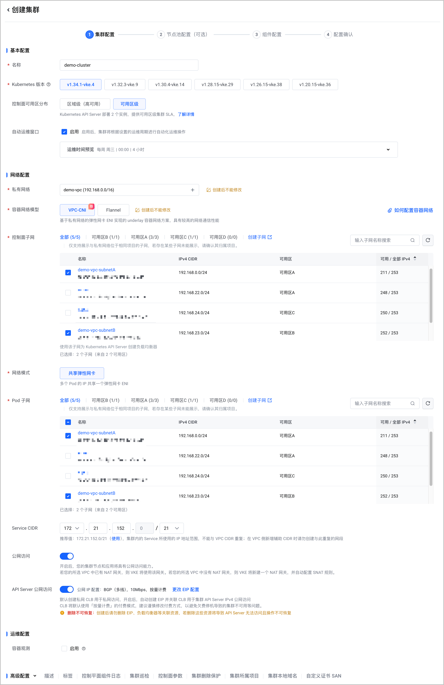
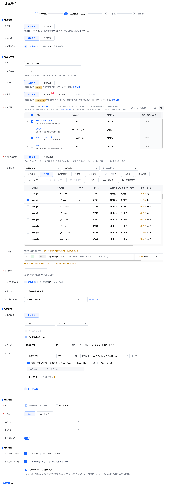
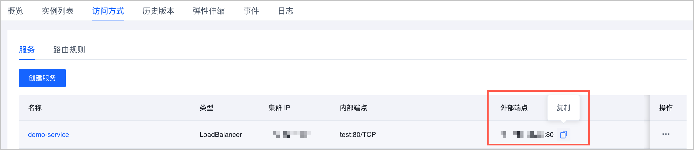
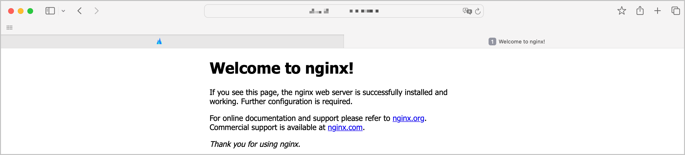

本文介绍通过容器服务（VKE）控制台创建集群并部署应用的操作步骤及参数配置，帮助您快速了解和使用 VKE 产品。

## 步骤一：创建集群

1. 登录 [容器服务控制台](https://console.volcengine.com/vke)。

2. 在顶部导航栏，选择靠近您业务的地域。

3. 在左侧导航栏单击 **集群**。

4. 在 **集群** 页面，单击 **创建集群**。

5. 在 **创建集群** 对话框，单击 **自定义托管集群** 区域下的 **立即创建**。

6. 在 **创建集群** 页面根据向导配置集群信息。

   本快速入门采用配置如下表所示，未提及的参数则保持默认配置。更多说明，请参见 [创建集群](https://www.volcengine.com/docs/6460/100936)。

   |参数 |说明 |示例 |图示 |
   |---|---|---|---|
   |**基本配置** ||| |
   |名称 |设置集群名称。 |**demo\-cluster** ||
   |Kubernetes 版本 |选择部署 Kubernetes 集群的版本。 |选择最新 Kubernetes 版本 ||
   |**网络配置** ||||
   |私有网络 |选择集群所属的私有网络（VPC）。选择 [准备工作](https://www.volcengine.com/docs/6460/100918) 中已完成的私有网络。 |**demo\-vpc (192.168.0.0/16)**  ||
   |容器网络模型 |配置集群的容器网络（CNI）方案。   * **VPC\-CNI**：基于私有网络的弹性网卡 ENI 实现的 Underlay 容器网络方案。VPC\-CNI 网络模型下容器网络支持选择 VPC 子网作为 Pod 子网。  * **Flannel**：属于 Underlay 网络方案（Flannel HostGateway），您可以自行定义 Kubernetes 集群的容器网络 Pod CIDR。 |**VPC\-CNI** ||
   |控制面子网 |选择私有网络下的子网。 |**demo\-vpc\-subnetA**、**demo\-vpc\-subnetB** ||
   |Pod 子网 |选择 Pod 使用的 VPC 子网，用于为部署在集群中的 Pod 分配 IP 地址。 |**demo\-vpc\-subnetA**、**demo\-vpc\-subnetB** ||
   |公网访问 |开启后，使用 NAT 网关实现集群内节点和应用的公网访问能力：   * 集群所属 VPC 中已有 NAT 网关：VKE 将使用该网关。  * 集群所属 VPC 中没有 NAT 网关：VKE 将新建一个 NAT 网关，并自动配置 SNAT 规则。新建的 NAT 网关使用 **使用量**（CU）计费模式。计费详情，请参见 [NAT 网关计费指引](https://docs.volcengine.com/docs/6404/1141190)。 |开启 ||
   |API Server 公网访问 |开启后，容器服务自动创建多线路类型（BGP）的公网 IP 并关联 CLB，使集群可以被公网访问。 |开启 ||
   |**运维配置** ||||
   |容器观测 |默认开启，开启后能够提供集群基础资源（节点、kubelet、kube\-state\-metrics 等）和控制面服务（kube\-apiserver、kube\-scheduler、etcd 等）的指标监控。 |关闭 ||

6. 单击页面右下角 **下一步：节点池配置**，根据向导配置节点池信息。

   |参数 |说明 |示例 |图示 |
   |---|---|---|---|
   |**节点信息** ||| |
   |节点池 |是否创建节点池：   * **立即创建**：创建包含 ECS 类型节点的节点池，该节点池也支持同步创建虚拟节点，并且默认使用 ECS 类型节点部署组件。  * **暂不创建**：系统自动创建虚拟节点，并且默认使用 VCI 部署组件。 |**立即创建** ||
   |节点来源 |Worker 节点的获取方式。 |**创建节点** ||
   |**节点池配置** ||||
   |名称 |设置节点池名称。 |**demo\-nodepool** ||
   |计费类型 |节点对应的云服务器资源的收费模式。 |**按量计费** ||
   |可用区 |选择新增节点所在的可用区。可用区是同一地域下电力、网络隔离的物理区域，可用区之间内网互通，不同可用区之间物理隔离。 |**多可用区** ||
   |节点子网 |选择新增节点所在的子网。 |**demo\-vpc\-subnetA**、**demo\-vpc\-subnetB** ||
   |计算规格 |选择新增节点（云服务器实例）的规格，支持选择多个实例规格。实例规格的详细说明，请参见 [实例规格清单](https://www.volcengine.com/docs/6396/69763)。 |**通用型 ecs.g3i.xlarge**  （4 vCPU \| 16 GiB） ||
   |节点数量 |新增节点的数量。节点个数和云服务器资源费用相关，请按需选择。 |**1** ||
   |**安全配置** ||||
   |登录方式 |节点实例的登录认证方式，支持通过 **密码** 和 **SSH 密钥对** 两种方式。 |选择 **密码** 并设置强密码 ||

7. 单击页面右下角 **下一步：组件配置**。组件包含了容器集群支持的所有功能性扩展组件及必要的系统组件。

   本示例保持默认配置即可。

8. 单击页面右下角 **下一步：配置确认**。确认集群配置信息并下拉到底部阅读服务条款后，勾选 **我已阅读并同意《容器服务专用服务条款》**  ，单击页面右下角 **确定**，启动集群创建流程。

   创建集群需要 15～20 分钟，您可以单击 **集群列表** 进行其他操作或留在集群创建页面，查看创建进度。

## 步骤二：部署应用

成功创建集群后，您可以通过无状态负载部署应用。

1. 在 **demo\-cluster** 集群管理页面的左侧导航栏，选择 **工作负载** \> **无状态负载**。

2. 在 **无状态负载** 页面，单击 **创建无状态负载**。

3. 在 **创建无状态负载** 页面，根据配置向导，配置无状态负载的参数。

   本快速入门采用配置如下列表所示，未提及的参数则保持默认配置。详细的参数说明，请参见 [创建无状态负载](https://www.volcengine.com/docs/6460/100971)。

   1. **基本信息**

      |参数 |说明 |示例 |
      |---|---|---|
      |名称 |填写工作负载的名称。 |**demo\-vke\-deployment** |
      |命名空间 |选择工作负载部署的命名空间。 |**default** |
      |实例个数 |输入无状态负载的 Pod 实例个数。 |**1** |
      |算力类型 |选择部署工作负载的基础设施资源：   * **云服务器实例 ECS**：在集群中的云服务器节点（Node）上部署该工作负载。  * **弹性容器实例** **VCI**：在集群中的弹性容器实例（VCI），即虚拟节点（VirtualNode）上部署该工作负载。弹性容器实例相关介绍，请参见 [什么是弹性容器实例](https://www.volcengine.com/docs/6460/76908)。 |**云服务器实例 ECS** |

   2. **容器配置**

      |参数 |说明 |示例 |
      |---|---|---|
      |**基本信息** |||
      |容器名称 |输入容器名称。 |**demo\-vke\-container** |
      |容器镜像 |输入不包含镜像版本（Tag）的镜像地址，或者单击 **选择镜像，**  选择 [准备工作](https://www.volcengine.com/docs/6460/100918) 中已上传到 CR 中的镜像。 |**doc\-cn\-beijing.cr.volces.com/vke/nginx\-demo** |
      |镜像版本 |选择镜像的版本，不选择则默认拉取 **latest** 版本。  > **注意**   > 若所选的镜像无 **latest** 版本，则此处必须填写或选择具体的镜像版本，否则无法创建工作负载。  |**v1.0** |
      |**容器端口** |||
      |端口 |配置容器中应用对容器外服务的连接端口。 |* 协议：**TCP**  * 端口号：**80**  * 端口名称：**demo\-port** |

   3. **高级配置**

      本示例中无需额外配置，全部保持默认配置，然后单击页面右下角的 **确定**。

4. 在 **无状态负载** 页面，查看已创建的无状态负载。

   单击无状态负载名称进入详情页后，单击 **实例列表** 页签，查看工作负载 Pod 实例的运行状态，状态显示为 **Running**，表示无状态负载运行正常。

## 步骤三：访问应用

完成应用部署以后，您可以通过 **服务** 访问应用，以验证应用是否部署成功。

1. 在 **无状态负载详情页**，单击 **访问方式** 页签。

2. 在 **访问方式** 页签，单击 **服务** 子页签，然后单击 **创建服务**。

3. 在 **创建服务** 页面，配置服务信息。完成配置后单击页面右下角 **确定**。

   本快速入门采用配置如下表所示，未提及的参数则保持默认配置。详细的参数说明，请参见 [通过控制台创建 CLB 负载均衡服务](https://www.volcengine.com/docs/6460/100988)。

   |参数 |说明 |示例 |
   |---|---|---|
   |**基本信息** |||
   |名称 |设置服务名称。 |**demo\-service** |
   |**访问配置** |||
   |访问类型 |服务的访问类型。 |**负载均衡（LoadBalancer）**  |
   |直通 Pod 模式 |开启后直接关联 Pod ENI 作为负载均衡器的后端。但负载均衡器允许的后端服务器数有限，需自行规划和保证。详细限制，请参见 [CLB 约束限制](https://www.volcengine.com/docs/6406/67902)。 |开启 |
   |负载均衡器 |配置服务的负载均衡器。 |选择 **公网访问**、**自动创建**，并自定义配置负载均衡器的 **名称** 和 **子网**，其余参数保持默认配置 |
   |端口映射 |配置服务端口与容器端口的映射关系。 |* 名称：**test**  * 服务端口：**80** |

4. 创建完成后，在 **访问方式** 页签的 **服务** 子页签下，复制 **外部端点** 的地址。

   

5. 在浏览器中输入 **外部端点** 地址，访问 Nginx 的欢迎页面。

   

## 步骤四：监控应用

完成应用部署后，可以通过云原生观测能力，监控应用的运行状态，包括 CPU 用量、内存用量等，协助后续的运维工作。相关说明，请参见 [开启观测](https://www.volcengine.com/docs/6460/1213992)。

## 释放资源

完成快速入门后，如果无需使用集群，请参考 [删除集群](https://www.volcengine.com/docs/6460/100941) 中的指引，删除集群及其关联资源；如果需要继续使用集群，请确保您的火山引擎账户余额（含代金券）不低于 100 元人民币，且除去代金券后账户余额不为零。

持续使用容器服务集群会有如下两类费用，详细的计费信息，请参见 [产品计费](https://www.volcengine.com/docs/6460/70612)：

* 集群托管费用：由容器服务收费。

* 云基础资源费用：集群中使用的 NAT 网关、CLB、公网 IP、云盘等其他火山引擎云产品费用，由其他云产品收费。
