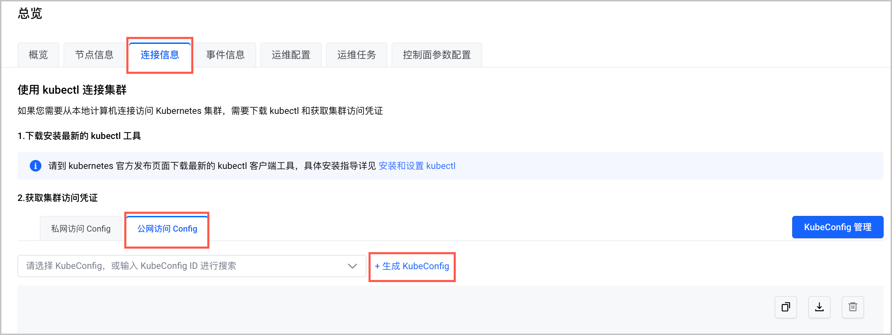
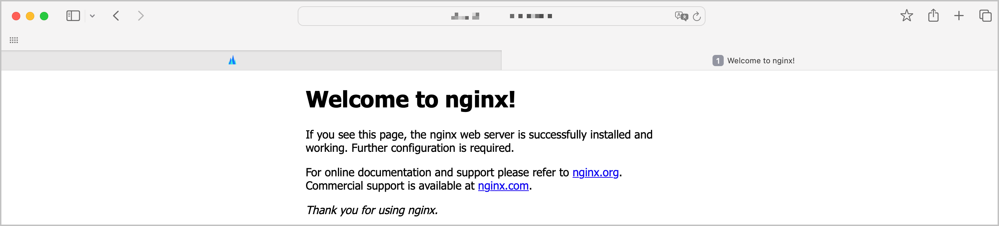

本文介绍通过容器服务（VKE）控制台创建集群后，使用 kubectl 命令行工具部署应用的操作步骤及参数配置，帮助您快速了解和使用 VKE 产品。

<span id=".5q2l6aqk5LiA77ya5Yib5bu66ZuG576k"></span>
## 步骤一：创建集群

详细的操作步骤和参数说明，请参见 [通过控制台使用容器服务](https://www.volcengine.com/docs/6460/70626) 中的 **步骤一：创建集群** 内容。

<div data-tips="true" data-tips-type="tip" data-tips-is-title="true">说明</div>


<div data-tips="true" data-tips-type="tip">若使用已有的集群，请确保已开启 <strong>API Server 公网访问</strong>。</div>


<span id=".5q2l6aqk5LqM77ya6L-e5o6l6ZuG576k"></span>
## 步骤二：连接集群

您可以通过 kubectl 客户端连接到已创建的集群。


1. 在本地环境中下载安装最新版本的 kubectl 工具。

   请从 Kubernetes 官方页面下载安装最新的 kubectl 客户端工具。具体安装指导，请参见 [安装和设置 kubectl](https://kubernetes.io/docs/tasks/tools/)。

3. 在 [容器服务控制台](https://console.volcengine.com/vke) 的 **集群** 页面，找到已创建的 **demo\-cluster** 集群，单击集群名称。

4. 在集群 **总览** 页面，单击 **连接信息** 页签。

5. 选择 **公网访问 Config** 页签，单击 **生成 Kubeconfig** 设置 **有效期**（本示例设置有效期为365天），获取集群访问凭证。

   <span> </span>

6. 在本地环境中打开`$HOME/.kube/config`文件，直接将获取到的集群访问凭证直接粘贴到`$HOME/.kube/config`文件中。

   <div data-tips="true" data-tips-type="warning" data-tips-is-title="true" data-wrapper-indent="1">注意   </div>


   <div data-tips="true" data-tips-type="warning" data-wrapper-indent="1"><code>$HOME/.kube/config</code>文件是您在本地环境中正确安装 kubectl 客户端后生成的文件，<code>$HOME</code>表示变量，由您本地环境的操作系统（macOS/Linux/Windows 等）、安装 kubectl 客户端的路径决定。   </div>


7. 在您的 kubectl 客户端执行如下命令，查询集群下的 Node（包括 Virtual Node）状态，验证是否连接成功。

   ```bash
   kubectl get node
   ```


   返回类似如下信息，表示 kubectl 已连接集群。

   ```bash
   NAME                     STATUS   ROLES    AGE     VERSION
   192.168.0.6              Ready    <none>   4h15m   v1.26.10-vke.11
   ```


<span id=".5q2l6aqk5LiJ77ya6YOo572y5bqU55So"></span>
## 步骤三：部署应用

完成集群和 kubectl 的连接后，您可以通过 kubectl 客户端创建无状态负载，部署应用。


1. 在您的本地环境中，新建`nginx.yaml`应用文件并复制如下内容到该文件。

   <div data-tips="true" data-tips-type="tip" data-tips-is-title="true" data-wrapper-indent="1">说明   </div>


   <div data-tips="true" data-tips-type="tip" data-wrapper-indent="1">请根据代码示例中的注释信息，更改参数值。   </div>


   ```yaml
   apiVersion: apps/v1
   kind: Deployment
   metadata:
     name: doc-deployment # 无状态工作负载名称
     namespace: default # 命名空间名称
   spec:
     replicas: 1 # Pod 实例个数
     selector:
       matchLabels:
         app: doc-deployment
     template:
       metadata:
         labels:  # 需要与后续创建的服务(Service )文件中 selector 的参数值保持一致
           app: doc-deployment
       spec:
         containers:
         - name: doc-deployment-container # 容器名称
           image: doc-cn-beijing.cr.volces.com/vke/nginx-demo:v1.0 # 可以替换为您自己的镜像地址，也可以直接使用该示例镜像地址
           ports:
           - containerPort: 80 # 容器开放的端口号
             protocol: TCP # 网络协议
   ```


2. 执行如下命令，部署应用。

   ```bash
   kubectl apply -f nginx.yaml
   ```


   预期返回结果如下所示：

   ```bash
   deployment.apps/doc-deployment created
   ```


3. 执行如下命令，查看应用部署状态。

   ```bash
   kubectl get deployment ${your_deployment_name}
   ```


   <div data-tips="true" data-tips-type="tip" data-tips-is-title="true" data-wrapper-indent="1">说明   </div>


   <div data-tips="true" data-tips-type="tip" data-wrapper-indent="1">请将<code>${your_deployment_name}</code>替换为您设置的无状态负载名称。例如<code>doc-deployment</code>，那么完整的命令为：   </div>


   <div data-tips="true" data-tips-type="tip" data-wrapper-indent="1">   ```bash
   kubectl get deployment doc-deployment
   ```
      </div>


   返回类似如下信息，表示应用部署成功。

   ```bash
   NAME             READY   UP-TO-DATE   AVAILABLE   AGE
   doc-deployment   1/1     1            1           85s
   ```


4. 在您的本地计算机`$home`目录下，新建`nginx-svc.yaml`服务文件，并复制如下内容到该文件。

   <div data-tips="true" data-tips-type="tip" data-tips-is-title="true" data-wrapper-indent="1">说明   </div>


   <div data-tips="true" data-tips-type="tip" data-wrapper-indent="1">请根据代码示例中的注释信息，按需更改参数值。更多说明，请参见 <a href="https://www.volcengine.com/docs/6460/1179596">通过 kubectl 创建 CLB 负载均衡服务</a>。   </div>


   ```yaml
   apiVersion: v1
   kind: Service
   metadata:
     name: nginx-svc # 服务名称
     namespace: default # 命名空间名称
   spec:
     selector: # 需要与之前创建的应用文件中 selector 的 matchLabels 参数值保持一致
       app: doc-deployment
     ports:
     - protocol: TCP # 端口协议
       name: doc-port # 端口映射的名称
       port: 80 # Service 对外提供服务的端口
       targetPort: 80 # 容器端口，即工作负载对外提供服务的端口号或端口名称，例如：Nginx 开放的默认端口号为 80
     type: LoadBalancer # 服务的类型，包括：Nodeport、ClusterIP 和 LoadBalancer
   ```


5. 执行如下命令，创建服务。

   ```bash
   kubectl apply -f nginx-svc.yaml
   ```


   预期返回结果如下所示：

   ```bash
   service/nginx-svc created
   ```


6. 执行如下命令，查看服务状态。

   ```bash
   kubectl get svc ${your_service_name}
   ```


   <div data-tips="true" data-tips-type="tip" data-tips-is-title="true" data-wrapper-indent="1">说明   </div>


   <div data-tips="true" data-tips-type="tip" data-wrapper-indent="1">请将<code>${your_service_name}</code>替换为您设置的服务名称，例如<code>nginx-svc</code>，那么完整的命令为：   </div>


   <div data-tips="true" data-tips-type="tip" data-wrapper-indent="1">   ```Bash
   kubectl get svc nginx-svc
   ```
      </div>


   返回类似如下信息，表示应用部署成功。

   ```Bash
   NAME        TYPE           CLUSTER-IP     EXTERNAL-IP    PORT(S)        AGE
   nginx-svc   LoadBalancer   172.**.**.**   180.**.**.**   80:31709/TCP   65s
   ```


7. 在浏览器中输入上一步获取到的 **EXTERNAL\-IP** 值，访问 Nginx 的欢迎页面。

   <span> </span>


<span id=".5q2l6aqk5Zub77ya55uR5o6n5bqU55So"></span>
## 步骤四：监控应用

完成应用部署后，可以通过云原生观测能力，监控应用的运行状态，包括 CPU 用量、内存用量等，协助后续的运维工作。相关说明，请参见 [开启观测](https://www.volcengine.com/docs/6460/1213992)。

<span id=".6YeK5pS-6LWE5rqQ"></span>
## 释放资源

完成快速入门后，如果无需使用集群，请参考 [删除集群](https://www.volcengine.com/docs/6460/100941) 中的指引，删除集群及其关联资源；如果需要继续使用集群，请确保您的火山引擎账户余额（含代金券）不低于 100 元人民币，且除去代金券后账户余额不为零。

持续使用容器服务集群会有如下两类费用，详细的计费信息，请参见 [产品计费](https://www.volcengine.com/docs/6460/70612)：


* 集群托管费用：由容器服务收费。

* 云基础资源费用：集群中使用的 NAT 网关、CLB、公网 IP、云盘等其他火山引擎云产品费用，由其他云产品收费。
