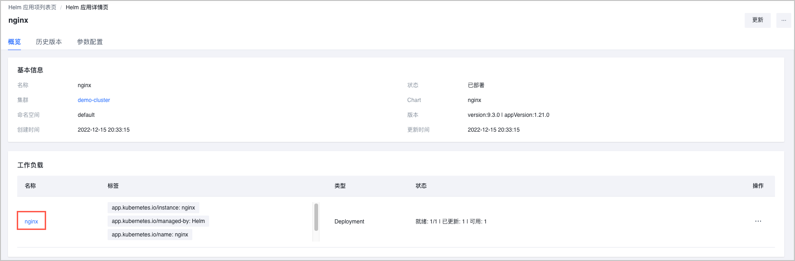
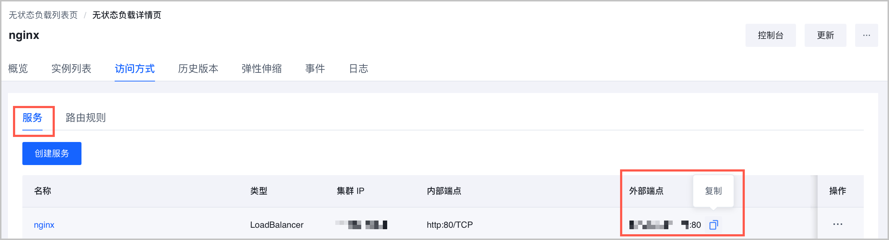
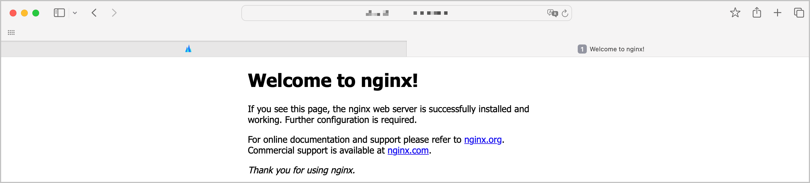

本文介绍通过容器服务（VKE）控制台创建集群后，使用 VKE 提供的应用模板部署您容器应用的操作步骤及参数配置，帮助您快速了解和使用 VKE 产品。

## 步骤一：创建集群

详细的操作步骤和参数说明，请参见 [通过控制台使用容器服务](https://www.volcengine.com/docs/6460/70626) 中的 **步骤一：创建集群** 内容。

## 步骤二：部署应用

创建集群后，您可以通过应用模板部署应用。本示例以 **nginx** 模板为例，描述部署应用的流程。

1. 在 [容器服务控制台](https://console.volcengine.com/vke) 左侧导航栏，选择 **应用中心 \> 应用模板**。

2. 在 **应用模板** 页面，找到 **nginx** 应用模板，鼠标悬停在该应用模板区域，然后单击 **部署**。

3. 在 **部署应用** 页面，根据如下表参数说明，配置参数。

   |参数 |说明 |示例 |
   |---|---|---|
   |**编排模板** |||
   |应用模板 |选择 nginx 的 Chart 版本。 |选择最新版本 |
   |参数配置 |配置传递到 Chart 的参数值的访问方法。 |保持默认配置 |
   |名称 |设置应用名称。 |**nginx** |
   |**部署环境** |||
   |集群 |选择 **步骤一** 中创建的 VKE 集群。 |**demo\-cluster** |
   |命名空间 |选择目标集群下的命名空间。 |**default** |
   |协议 |阅读了解协议内容后勾选协议。 | **√**  |

4. 单击 **确定**，部署完成应用。

   应用部署完成后会显示在 **Helm 应用** 页面。

5. 获取应用的外部访问地址，访问应用，查看部署状态。

   1. 在 **Helm 应用** 页面，单击上一步部署完成的应用名称 **nginx**。

   2. 在 **Helm 应用详情页**，单击 **工作负载** 区域下的工作负载名称。

      

   3. 在 **无状态负载详情页**，单击 **访问方式** 页签，并在 **服务** 子页签下复制 **外部端点** 的地址。

      

   4. 在浏览器中输入 **外部端点** 地址，访问 Nginx 的欢迎页面。

      

## 步骤三：监控应用

完成应用部署后，可以通过云原生观测能力，监控应用的运行状态，包括 CPU 用量、内存用量等，协助后续的运维工作。相关说明，请参见 [开启观测](https://www.volcengine.com/docs/6460/1213992)。

## 释放资源

完成快速入门后，如果无需使用集群，请参考 [删除集群](https://www.volcengine.com/docs/6460/100941) 中的指引，删除集群及其关联资源；如果需要继续使用集群，请确保您的火山引擎账户余额（含代金券）不低于 100 元人民币，且除去代金券后账户余额不为零。

持续使用容器服务集群会有如下两类费用，详细的计费信息，请参见 [产品计费](https://www.volcengine.com/docs/6460/70612)：

* 集群托管费用：由容器服务收费。

* 云基础资源费用：集群中使用的 NAT 网关、CLB、公网 IP、云盘等其他火山引擎云产品费用，由其他云产品收费。
