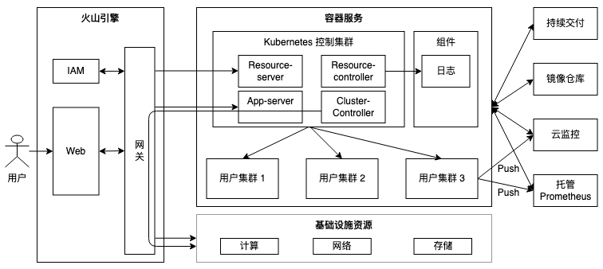
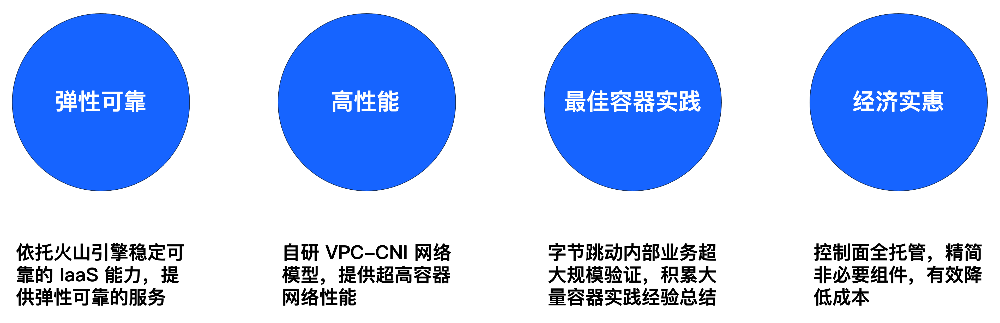

# 产品优势

VKE 面向容器化和 AI 工作负载提供托管、弹性、可靠的 Kubernetes 运行环境。

## 赋能 AI

- 支持基于 vLLM、SGLang、Dynamo 等框架编排推理服务。
- 提供模型缓存与镜像加载加速能力。
- 支持 GPU 在线、离线任务混部和多模型混部。
- 支持 Prefill-Decode 实例独立扩缩容。

## 可视化与易用性

- 提供向导式控制台操作和节点全生命周期管理。
- 支持创建、升级和管理 Kubernetes 集群。
- 提供应用构建、部署、监控和运维的一站式能力。
- 集成 Helm 模板，降低应用部署成本。

## 弹性与可靠性

- 支持节点和工作负载水平扩缩容。
- 集成 VCI，提供按需、秒级弹性和沙箱隔离能力。
- 控制面采用高可用设计，并提供容器自动恢复能力。
- 支持网络隔离、访问控制、数据加密、IAM 与 RBAC 联动。

## 调度能力

VKE 扩展 Kubernetes 原生调度能力，支持 Binpack、Spread、Gang、Capacity、弹性资源优先级、负载感知和拓扑感知等调度策略。具体能力和适用条件以对应功能文档为准。

## 云原生兼容和产品集成

VKE 兼容 Kubernetes API 和 `kubectl`，并可与持续交付、镜像仓库、日志服务、托管 Prometheus 和云监控等火山引擎产品协同使用。

图示要点：VKE 作为容器编排基础设施，与计算、网络、存储、镜像、交付、监控和日志等云产品协同。使用某项集成能力前，应核对其地域支持、权限和前置资源要求。

## 与自建 Kubernetes 的主要差异

| 维度 | VKE | 自建 Kubernetes |
|---|---|---|
| 控制面 | 托管并提供专业服务 | 用户自行部署、维护和保障高可用 |
| 弹性 | 集成节点、工作负载与 VCI 弹性能力 | 用户自行搭建伸缩体系 |
| 网络 | 集成 VPC-CNI 等云上网络能力 | 用户自行选择和适配插件 |
| 运维 | 提供升级、监控、日志、诊断和安全能力 | 用户自行建设运维平台 |
| 成本结构 | 减少控制面和平台研发运维投入 | 需要承担集群平台研发与运维成本 |

图示要点：VKE 由云平台提供集群控制面和配套云原生能力，用户主要管理业务工作负载；自建 Kubernetes 则需要用户承担更多集群部署、集成、升级和运维工作。

详细能力和对比口径请以[官网原文](https://docs.volcengine.com/docs/vke/benefits?lang=zh)为准。
