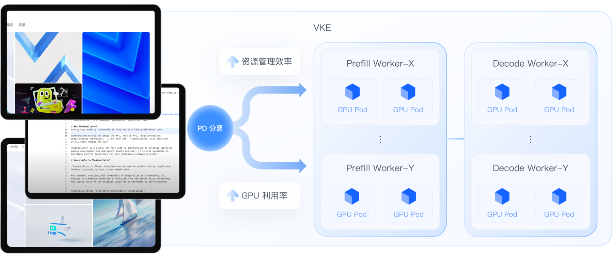
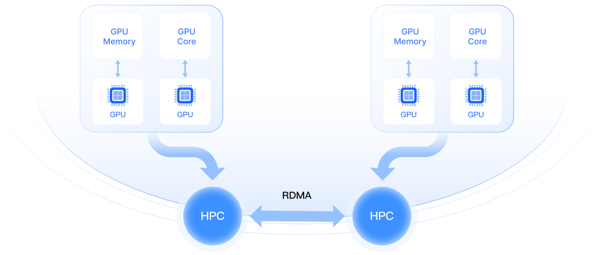
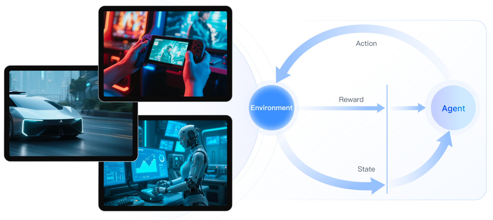
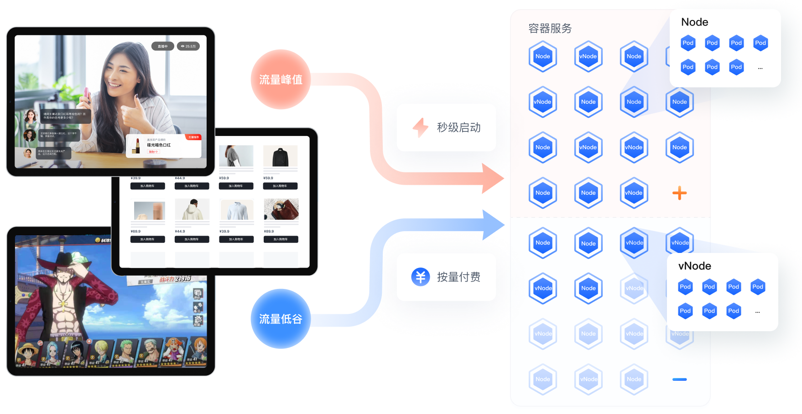

# 应用场景

VKE 适用于需要 Kubernetes 编排、弹性资源管理和容器化应用生命周期管理的业务。

## 分布式推理

通过 Prefill-Decode 分离编排和独立扩缩容管理推理工作负载，提高 GPU 资源利用效率。

图示要点：Prefill Worker 和 Decode Worker 分别组成资源池并独立扩缩容，从而使不同推理阶段按各自资源需求进行调度。

## AI 训练

使用 Kubernetes 管理分布式训练任务，支持多节点 GPU 资源分配和弹性扩缩容。

图示要点：训练任务跨多个 GPU 或高性能计算节点运行，节点之间通过 RDMA 等高性能网络交换训练数据。

## 强化学习

面向多角色任务提供编排和高并发调度能力，并通过诊断和自愈能力提升训练稳定性。

图示要点：Agent 向环境发出动作，环境返回状态和奖励，形成持续训练闭环；VKE 用于承载和调度该闭环中的计算工作负载。

## 高弹性业务

适用于直播、电商、游戏等流量波动明显的业务，通过按需资源和弹性伸缩应对业务峰值。

图示要点：稳定负载可运行在常驻节点上，峰值增量通过 VCI 等按需资源快速承接，流量回落后释放弹性资源，以减少闲置成本。

## 微服务和持续交付

适用于应用微服务化、敏捷开发和 DevOps 持续交付，通过标准 Kubernetes 工作负载、服务发现和发布能力管理应用。

不同场景依赖的 GPU、VCI、网络、存储和调度能力可能受地域、账号类型及产品配额限制。实施前应继续阅读对应功能文档。
