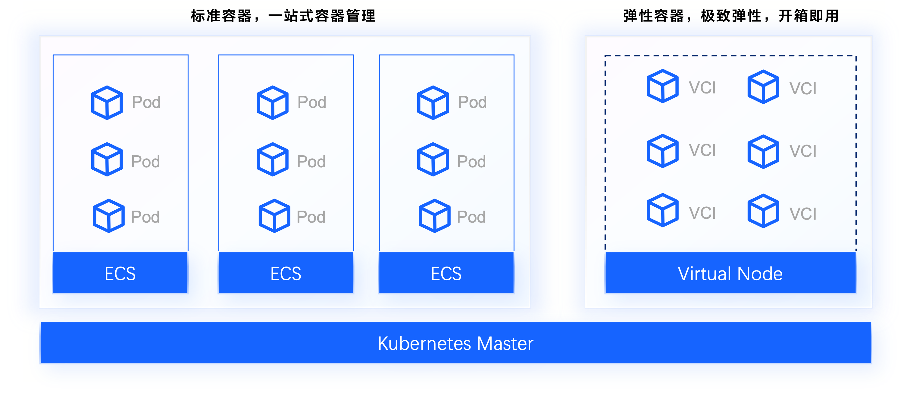
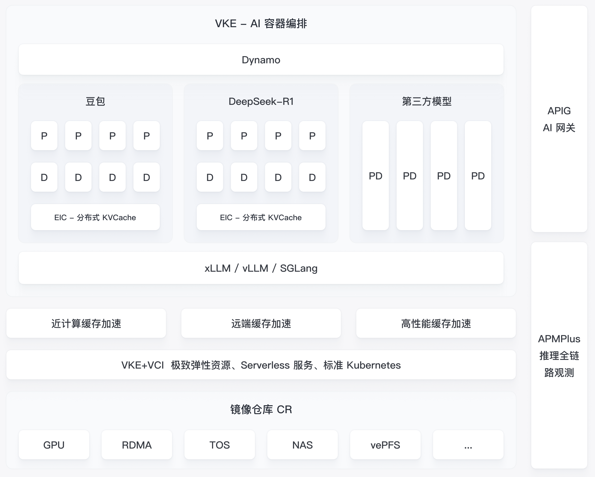
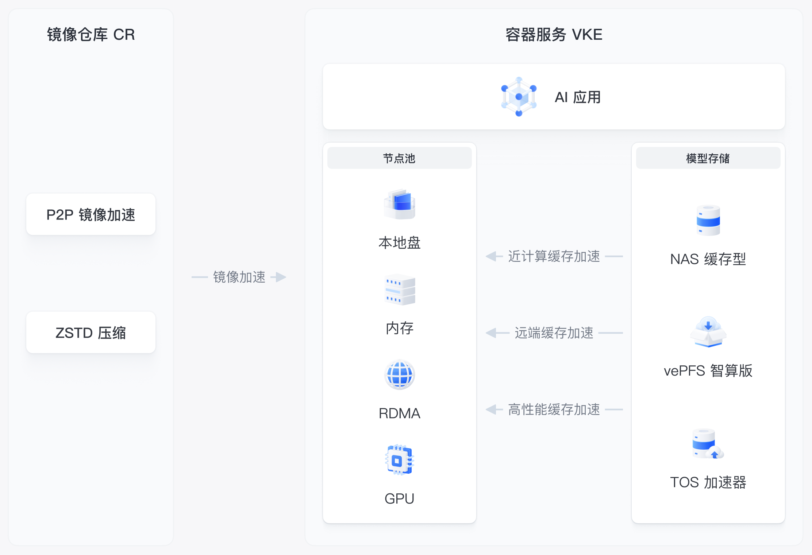
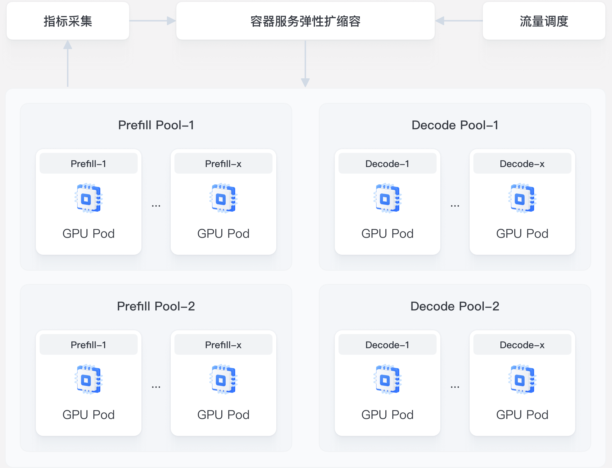

# 什么是容器服务

容器服务（Volcengine Kubernetes Engine，VKE）是以容器为核心的 Kubernetes 集群管理服务。VKE 提供云上高可用 Kubernetes 集群的创建和管理能力，并支持容器化应用的可视化生命周期管理。

## 为什么选择 VKE

VKE 将 Kubernetes 与火山引擎的计算、网络和存储服务集成，并可配合镜像仓库、持续交付、托管 Prometheus、日志服务和微服务引擎等产品，覆盖应用构建、部署、发布和监控流程。

与自建 Kubernetes 相比，VKE 的主要差异包括：

| 维度 | VKE | 自建 Kubernetes |
|---|---|---|
| 集群管理 | 通过控制台创建集群，提供经过测试和安全加固的 Kubernetes 版本 | 用户自行部署和维护 |
| 网络 | 提供高性能网络插件和多种网络模型 | 用户自行选择、部署并适配网络插件 |
| 存储 | 集成 EBS、TOS、NAS 等存储并提供 CSI 组件 | 用户自行搭建存储并完成 CSI 接入 |
| 应用 | 支持应用发布、监控和弹性伸缩 | 用户自行建设相关能力 |
| 运维 | 支持版本升级、伸缩、日志与监控能力 | 用户自行部署运维系统 |
| 安全 | 提供托管、安全加固、网络隔离和访问控制 | 用户自行保障环境安全 |

## 容器类型

VKE 支持使用 ECS 节点构建标准容器集群，也支持通过 VCI 使用弹性容器实例；同一集群可以按业务需求组合两类资源。

| 类型 | 标准容器 | 弹性容器 |
|---|---|---|
| 基础设施 | 云服务器 ECS | 弹性容器实例 VCI |
| 管理特点 | 节点规格丰富，支持完整的节点和容器管理 | 无需预先创建节点，按需创建容器实例 |
| 弹性特点 | 依据节点容量进行调度和扩缩容 | 支持秒级弹性和按需付费 |
| 典型场景 | 微服务、持续交付、稳定在线业务、GPU 与复杂调度 | 峰谷明显业务、任务型计算、事件驱动和临时在线业务 |

图示要点：标准容器运行在 ECS 节点上，适合稳定容量和节点级管理；弹性容器由 VCI 按需提供计算资源，适合突发和临时负载。两种资源可以在同一 VKE 集群中组合使用。

## 产品架构与 AI 能力

VKE 为 AI 负载提供模型部署加速、应用编排和资源调度能力，包括模型加载加速以及 Prefill-Decode 分离场景下的弹性调度。

### 推理服务架构

图示要点：VKE 在 Kubernetes 资源编排基础上承载推理服务，并通过计算、网络、存储、可观测和弹性能力支撑模型部署与访问。实际组件组合取决于使用的推理框架和功能配置。

### 模型加载加速

图示要点：通过模型缓存、镜像或存储加速等能力缩短模型数据进入计算实例的路径，降低推理实例启动和扩容等待时间。具体支持范围应以对应功能文档为准。

### Prefill-Decode 分离

图示要点：推理请求的 Prefill 与 Decode 阶段由不同工作负载承担，可根据两个阶段的负载分别调度和扩缩容，以提高 GPU 利用率并优化时延。

图片所示能力可能随产品版本调整，实施前应继续阅读对应功能文档，并以[官网原文](https://docs.volcengine.com/docs/vke/what-is-vke?lang=zh)和控制台实际能力为准。

## 相关学习资源

- [基本概念](https://docs.volcengine.com/docs/vke/terms?lang=zh)
- [快速入门](../getting-started/)
- [常见问题](../faqs/)
- [云服务依赖关系](https://docs.volcengine.com/docs/vke/dependencies-between-vke-and-other-cloud-services?lang=zh)
- [Kubernetes 官方文档](https://kubernetes.io/docs/)
